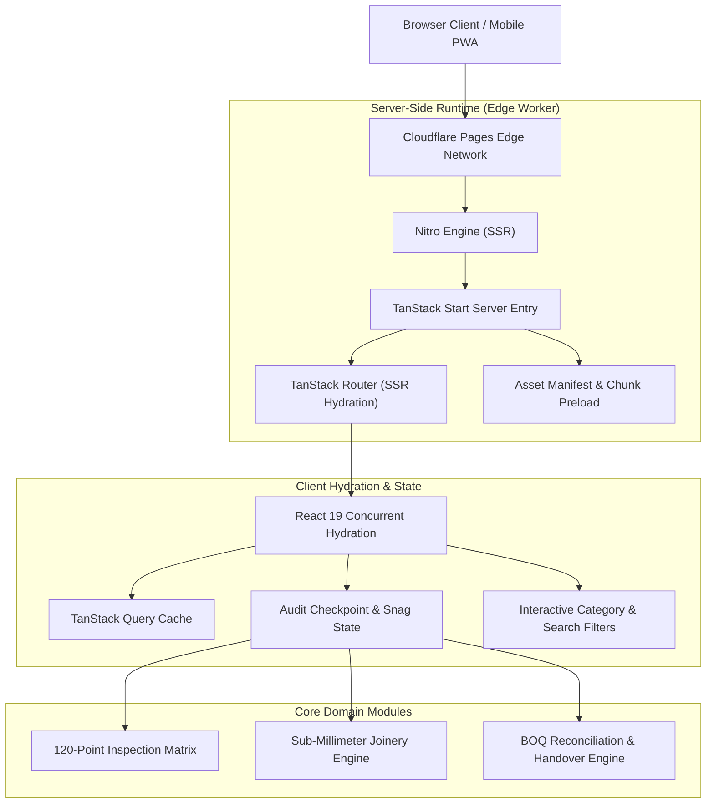

# Interior Support — Client-Side Interior Quality Audit & PMC Platform

[](https://react.dev)
[](https://www.typescriptlang.org/)
[](https://tanstack.com/start)
[](https://tanstack.com/router)
[](https://tailwindcss.com/)
[](https://nitro.unjs.io/)
[](https://vitest.dev/)
[](https://pages.cloudflare.com/)

**Interior Support** is an independent, client-side interior quality audit and Project Management Consultancy (PMC) platform engineered for premium residential and commercial interior fit-outs. 

Unlike contractor-driven execution trackers, Interior Support operates with fiduciary duty strictly toward the property owner—enforcing a rigorous **120-point quality audit framework**, sub-millimeter joinery tolerance inspections, MEP validation, and contractor bill-of-quantities (BOQ) verification across Bengaluru.

---

## 🏛️ System Architecture



---

## ⚡ Key Engineering & Domain Capabilities

### 1. 120-Point Snag Audit Matrix
- **Civil & Shell**: Plaster evenness, diagonal squareness (laser right-angle checks), dampness / core moisture testing (<12% moisture thresholds).
- **Joinery & Millwork**: Shutter gap tolerances ($\le 0.5\,\text{mm}$), edge-banding bonding strength, Blum / Hettich hardware authenticity and cycle-load verification.
- **Electrical & MEP**: Phase balance, earth-leakage tripping speeds, conduit layout verification against architectural single-line diagrams (SLDs).
- **Finishes & Coatings**: Specular gloss consistency, PU / melamine coat micron thickness testing, paint touch-up masking boundaries.

### 2. High-Performance Edge SSR Architecture
- **Full-Stack SSR via TanStack Start**: Server-side rendering at edge nodes ensures ultra-low First Contentful Paint ($< 200\,\text{ms}$) while preserving full client-side route transitions without blank flashes.
- **Type-Safe File-Based Routing**: Strict compile-time route definition with `@tanstack/react-router` and automated tree generation (`routeTree.gen.ts`).
- **Zero Hydration Mismatch Safety**: Dedicated SSR error boundary wrapping (`server.ts`) guarding against client/server state drift during concurrent React 19 streaming.

### 3. Reactive Search, Filtering & Snag Explorer
- **Interactive Checkpoint Matrix**: Multi-stage inspection filtering (Pre-fitout, Mid-fitout MEP, Pre-handover Snagging, Post-handover).
- **Journal & Case Briefings**: Live keyword indexing, category chip isolation, contractor audit protocols, and printable PDF inspection checklists.
- **Direct Dispatch Pipelines**: Client booking pipeline with instant stage qualification, automated WhatsApp dispatch bridge, and RFC-compliant mailto payload formatting.

---

## 📁 Repository Structure

```text
interior-support/
├── public/                 # Static assets, web manifests, sitemap, site icons
├── src/
│   ├── assets/             # Compressed WebP photography & architectural diagrams
│   ├── components/         # Modular UI design system
│   │   ├── ui/             # Radix UI primitives (dialogs, accordions, tooltips, cards)
│   │   ├── site-chrome.tsx # Global architectural header, navigation, and footer
│   │   ├── brand-logo.tsx  # Crisp SVG architectural mark & responsive typography
│   │   └── scroll-motion.tsx # IntersectionObserver with reduced-motion support
│   ├── data/
│   │   ├── articles.ts     # Technical briefings, defect guides, contractor checklists
│   │   └── gallery-items.ts# Curated audit inspection documentation & joinery details
│   ├── routes/             # TanStack Start file-based routes
│   │   ├── index.tsx       # Flagship landing page & credibility pillars
│   │   ├── about-us.tsx    # PMC methodology & fiduciary engineering standards
│   │   ├── services.tsx    # 4-stage audit service breakdown & checkpoint matrix
│   │   ├── services_.*.tsx # Deep-dive service specs (BOQ, MEP, Joinery, Handover)
│   │   ├── blog.tsx        # Journal archive with live search & tag chips
│   │   ├── blog_.$slug.tsx # Individual technical briefings with interactive checklists
│   │   └── contact.tsx     # Site audit inquiry & instant dispatch workflow
│   ├── test/               # Vitest test suites & DOM test environment setup
│   ├── router.tsx          # TanStack Router instance & QueryClient hydration
│   ├── server.ts           # Nitro / Cloudflare Pages SSR server lifecycle handler
│   └── styles.css          # Tailwind CSS v4 styling & typography tokens
├── vitest.config.ts        # Vitest test configuration (jsdom environment)
├── vite.config.ts          # Vite & TanStack Start compiler pipeline
└── package.json            # Dependencies, test scripts, and build targets
```

---

## 🛠️ Technology Stack

| Layer | Technologies |
| :--- | :--- |
| **Framework & SSR** | [TanStack Start](https://tanstack.com/start), [React 19](https://react.dev), [Nitro](https://nitro.unjs.io/) |
| **Routing & Navigation** | [TanStack Router](https://tanstack.com/router) (Strict Type-Safe Routes) |
| **State & Data Fetching** | [TanStack React Query](https://tanstack.com/query) v5 |
| **Styling & Design System** | [Tailwind CSS v4](https://tailwindcss.com/), Radix UI Primitives, Lucide Icons |
| **Testing** | [Vitest](https://vitest.dev/), Testing Library, JSDOM |
| **Language & Tooling** | TypeScript 5.8, Vite 8, ESLint, Prettier |
| **Deployment Target** | Cloudflare Pages (Edge Workers runtime) |

---

## 🚀 Getting Started

### Prerequisites
- **Node.js**: `v20.x` or `v22.x` / `v24.x`
- **npm** or **bun**

### Installation

```bash
# Clone the repository
git clone https://github.com/praveen-kumary/interior-support.git
cd interior-support

# Install dependencies
npm install
```

### Development Server

Start the local development server with Hot Module Replacement (HMR):

```bash
npm run dev
```

The application will be accessible at `http://localhost:3000`.

### Running Tests

Execute the unit test suite via Vitest:

```bash
npm test
```

### Production Build

Compile the production client assets and Nitro server output:

```bash
npm run build
```

To preview the production build locally:

```bash
npm run preview
```

---

## 🚢 Deployment

The build output is configured for zero-configuration deployment to **Cloudflare Pages**:
- Output directory: `.output/public`
- Server handler: `.output/server/index.mjs`
- Preset: `cloudflare_pages` (handled automatically via Nitro)

---

## 📄 License

This repository is maintained by [Praveen Kumar](https://github.com/praveen-kumary). All rights reserved.
